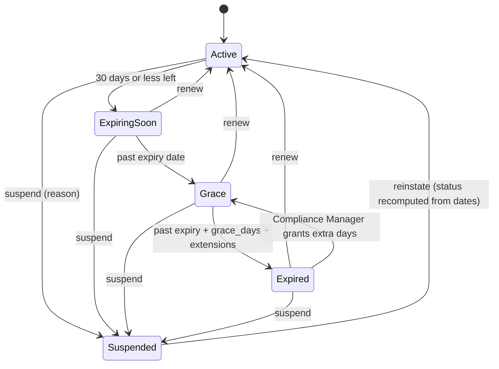

# Warehouse licence management

Warehouse licences are kept in the billing app and checked whenever an invoice is issued. A licence is either:

- a **statutory permit** of a warehouse, such as an FSSAI licence, fire NOC or bonded warehouse licence, or
- a **capacity or seat licence** the warehouse sells to a storage client, measured in pallets, square feet or software seats.

| Piece | Where |
| --- | --- |
| Rules (state machine, alerts, capacity, proration) | `shared/licenses.ts` (pure functions, unit-tested in `shared/licenses.test.ts`) |
| Schema | `server/migrations/030_warehouse_licenses.sql` |
| Invoice gate, print numbers, hourly job | `server/src/services/licenses.ts` |
| Hook into invoice issuing | `server/src/services/documents.ts` (`gateLicenses` in `createInvoice` / `updateInvoice`) |
| REST API | `server/src/routes/shop/licenses.ts` |
| Screens | `src/pages/app/Licenses.tsx`, `LicenseDetail.tsx`, `src/components/LicenseGatePrompt.tsx` |
| Integration tests | `server/test/licenses.test.ts` |

## 1. Schema

```
shops (company / SaaS tenant)
 └─< branches (warehouses)
      └─< warehouse_licenses >─o customers (storage client, optional)
            ├─< license_overrides   grace extensions + documented invoice overrides (append-only)
            ├─< license_alerts      one row per reminder sent (PK makes the job idempotent)
            └─< invoice_licenses >─ invoices   what each issued invoice was checked against
```

| Table | Key columns |
| --- | --- |
| `warehouse_licenses` | `license_type` (regulatory, saas_seat, storage_capacity), `regulatory_kind` (fssai, fire_noc, bonded_warehouse, trade, drug, pollution, other), `license_number`, `issuing_authority`, `issue_date`, `expiry_date`, `grace_days`, `max_capacity` + `capacity_unit`, `document_url`, `status`, `suspended` + `suspended_reason`, `enforce_scope` (all, service_items, none), `print_on_invoice`, billing terms (`term_start`, `renewal_item_id`, `renewal_price`, `term_months`, `auto_renewal_invoice`, `renewal_lead_days`, `renewal_invoiced_for`, `usage_item_id`, `overage_rate`, `credit_balance`) |
| `license_overrides` | `kind` (grace_extension, invoice_override), `extra_days`, `for_expiry`, `invoice_id`, `reason` (at least 10 characters, enforced by a CHECK), `granted_by` + `granted_by_name`, `revoked_at` / `revoked_by_name` |
| `license_alerts` | PK (`license_id`, `for_expiry`, `threshold`), `threshold` in (90, 60, 30, 7, 0), `delivered` |
| `invoice_licenses` | PK (`invoice_id`, `license_id`), `status_at_issue`, `override_id` |

**Integrity**

- **Same-shop references.** Every reference is a composite foreign key `(shop_id, x_id) → parent (shop_id, id)`. The database itself refuses a licence that points at another shop's warehouse, customer, item, user or invoice, whatever the API does.
- **No cascading deletes.** Every foreign key is `RESTRICT` or `SET NULL`, as `docs/DATABASE.md` requires. A licence with any history can only be suspended, never deleted.
- **CHECK constraints.**
  - Expiry is on or after the issue date.
  - A regulatory licence has a `regulatory_kind`; other types don't.
  - Capacity and seat licences have a `max_capacity`.
  - A grace extension has `extra_days`.
- **Unique licence number.** It is unique per shop, type and kind, ignoring case.
- **Indexes.**
  - Every foreign key column (the schema test checks this).
  - `expiry_date`, for the job.
  - `(shop_id, status)`.
  - Partial indexes on the optional links.
- **Row-level security.** All four tables have forced row-level security with a `tenant_isolation` policy and the read-only `backup_read` policy.

`status` is stored so lists and reports can filter by it, but it is **never trusted**. Billing always recomputes it from the dates, so a stale stored value can't let an invoice through.

## 2. Status state machine



`licenseStatus(dates, today, extraGraceDays)` in `shared/licenses.ts` checks these in order. The first that matches wins:

1. `suspended` flag set → **Suspended**.
2. More than 30 days to expiry → **Active**.
3. 0 to 30 days to expiry → **Expiring soon**.
4. Today on or before `expiry + grace_days + extensions` → **Grace**.
5. Otherwise → **Expired**.

Only **Expired** and **Suspended** block billing (`blocksBilling`). Grace and Expiring soon let invoices through, with a warning shown after issuing.

**Grace extensions** are `license_overrides` rows of kind `grace_extension`, tied to the expiry date they were granted for (`for_expiry`).

- Renewing retires them automatically, because the new expiry date no longer matches.
- They can be withdrawn, which sets `revoked_at` and keeps the row.
- Each grant is at most 90 days, and they add up to at most 180 days per expiry date.

## 3. API (`/api/shop`, session or bearer auth, CSRF header)

| Method and path | Permission | Purpose |
| --- | --- | --- |
| `GET /licenses?status=&type=&branchId=` | licenses.read | List with computed status and counts per status |
| `GET /licenses/:id` | licenses.read | Licence, overrides, reminders sent, invoices checked |
| `POST /licenses` | licenses.write | Create |
| `PATCH /licenses/:id` | licenses.write | Correct details (a later expiry date must go through renew) |
| `POST /licenses/:id/renew` | licenses.write | New expiry date, and optionally a new number or document; starts a new term |
| `POST /licenses/:id/suspend` and `/reinstate` | licenses.write | With a mandatory reason |
| `POST /licenses/:id/grace` | licenses.override | `{days, reason}`: temporary grace extension |
| `POST /licenses/:id/overrides/:oid/revoke` | licenses.override | Withdraw a grace extension |
| `POST /licenses/:id/change-capacity` | licenses.write | Mid-term upgrade or downgrade with proration |
| `POST /licenses/check-invoice` | sales.write | Dry run of the invoice gate, so the form can warn early |
| `DELETE /licenses/:id` | licenses.write | Only for a licence with no history |

**Roles**

- **Compliance Manager** (new role): read, write and override.
- **Manager** and **Owner**: everything.
- **Accountant**, **Warehouse** and **Viewer**: read.
- **Sales Staff**: none.

### The invoice gate

The gate is a service-level hook, not Express middleware. Invoices are issued from the invoice form, POS, delivery challans, recurring profiles, edits of issued invoices and background jobs. A route middleware would protect only the routes it is mounted on, while `createInvoice` and `updateInvoice` are the single place every issued invoice passes through.

```ts
// server/src/services/documents.ts (simplified)
export async function createInvoice(db, req, shopId, input, opts) {
  let gate = null;
  if (opts.issue) {
    const g = await gateLicenses(db, req, shopId, input, source, !!opts.madeOffline);
    gate = g.gate;
    if (g.held) opts = { ...opts, issue: false };            // recurring: saved as a draft instead
    if (gate && gate.lines !== input.lines) input = { ...input, lines: gate.lines }; // overage line added
  }
  // ... compute totals, insert, issue (number, stock) ...
  if (opts.issue && gate) await recordLicenseGate(db, req, shopId, row.id, gate);  // invoice_licenses + overrides
}
```

What `licenseGate()` in `services/licenses.ts` does:

1. **Finds the licences that gate this invoice** (`gatesInvoice`). These are licences of the same warehouse with `enforce_scope` other than `none`, either warehouse-wide or for this invoice's client. With `service_items` scope, only invoices that have a service line count (storage, inward handling, subscriptions).
2. **Blocks** with HTTP `409 license_blocked` and the licence details if any of them is Expired or Suspended **on the invoice date or today**, so back-dating can't get round it.
   - To issue anyway, the caller sends `licenseOverride: {reason}`.
   - The caller must hold `licenses.override` (otherwise `403 license_override_forbidden`).
   - The reason must be at least 10 characters (otherwise `400 license_override_reason`).
3. **Checks capacity.** For each capacity or seat licence with a `usage_item_id`, it adds up the quantity billed on that item.
   - Above `max_capacity`, it answers `409 license_capacity` with the licensed, billed and excess quantities, the overage amount and a suggested upgrade size.
   - `licenseOverage: 'bill'` cuts the usage lines back to the licensed quantity and adds an overage line at `overage_rate` (`splitOverage`).
   - `licenseOverage: 'allow'` lets the excess through without charge (needs `licenses.override` and a reason).
4. **Returns warnings** for licences in Grace or Expiring soon. They are sent back as `licenseWarnings` and shown to the user.
5. **Records the result** once the invoice exists (`recordLicenseGate`): each licence checked and its status then go into `invoice_licenses`, and each override goes into `license_overrides` linked to the invoice, plus the audit log.

The invoice form shows the dialog in `LicenseGatePrompt.tsx` (bill the overage, or override with a reason) and resends with the user's choices.

### Licence numbers on invoices

When an invoice is issued, the print snapshot stores the **valid** regulatory licences of the dispatching warehouse that have `print_on_invoice` set. They print under the GSTIN on the A4 tax invoice, the server PDF and thermal receipts.

- Because they are frozen in the snapshot, a reprint shows what was valid on the day of issue.
- An expired or suspended number is never printed.

### Hourly job (`runLicenseJob`, idempotent)

It is scheduled hourly with the other jobs. Every step is idempotent, so running it more than once a day (or after a restart) is harmless.

1. **Statuses.** It saves the status the dates now give, and audits each change (`status_change`).
2. **Reminders.** It sends the 90, 60, 30, 7 and 0-day reminders to the owner, managers and Compliance Managers.
   - The `license_alerts` primary key means each reminder goes out once per expiry date, even with two servers.
   - After downtime, only the current reminder goes out (`dueAlert`), not every one that was missed.
3. **Renewal invoices.** For capacity and seat licences sold to a client with auto-renewal on, it makes a **draft** renewal invoice `renewal_lead_days` (default 30) before expiry.
   - It is made once per expiry date (`renewal_invoiced_for`).
   - The invoice covers the next term (`nextTerm`), and any downgrade credit is applied as an amount discount.
   - It is a draft so a person reviews it before it becomes a tax invoice.

## 4. Edge cases

**Mid-term upgrades and downgrades** (`change-capacity`)

- **Price.** The new price per term defaults to the same rate per unit (`scaledPrice`); an explicit price can be given.
- **Proration.** It is by day, counting both ends: `amount = |new − old| × days_left / term_days` (`prorate`). It handles leap years (a 366-day term) and month ends (31 Jan + 1 month = 28/29 Feb).
- **Upgrade.** A draft invoice for the prorated amount, using the renewal item.
- **Downgrade.** No negative invoice. The amount is added to `credit_balance` and comes off the next renewal invoice as a discount.
  - A discount known at the time of supply and shown on the invoice reduces the taxable value under section 15(3)(a) of the CGST Act.
  - If the client leaves before renewing, the credit is refunded with a credit note. This is a manual step, and the balance stays visible on the licence.
- **Allowed window.** The effective date must be inside the current term. A licence that is expired or suspended can't be resized; renew or reinstate it first.
- **Several changes in one term.** Each is prorated from its own effective date against the price then in force, so changes add up correctly.

**Tax proration**

- GST is worked out by the normal engine on the prorated taxable value, so rounding happens once per line, to the paisa, as on every invoice.
- CGST+SGST or IGST follows the client's place of supply.
- The GST rate used is the renewal item's rate on the day the invoice is made (the time of supply). If the rate changed mid-term, the upgrade invoice uses the new rate, which is correct because the supply happens now.
- Overage lines use the usage item's tax rate, at the overage price.

**Other cases**

- **Back-dated invoices.** The status is checked on both the invoice date and today; either one blocking stops the invoice.
- **Drafts.** Drafts can be saved while a licence is blocked; only issuing is checked. An issued invoice that is edited is checked again.
- **Offline POS bills.** A bill made offline at the counter has already been handed to the customer. It is kept, the licence status is recorded, and the breach goes into the audit log (`license_breach_offline`).
- **Recurring invoices.** If a licence blocks one, it is saved as a draft and audited (`license_hold`); the profile is not switched off.
- **Several licences on one invoice.** The FSSAI licence and the client's capacity licence are checked together. The form keeps the choices from each dialog, such as an override reason followed by billing the overage.
- **Renewal while an extension is active.** Extensions are tied to the old expiry date, so they stop counting after renewal; the history keeps them labelled "Earlier term".
- **Users who switched organisation.** An override by an owner who switched in from another organisation keeps their name but no user link, because the composite foreign key requires a user of the same shop.
- **Document links.** Only `http(s)` links are accepted (no `javascript:` or `data:` links), and they open with `rel="noopener noreferrer"`.
- **Custom role permissions.** If a shop has its own permission matrix for a role, the new licence permissions start unticked for that role until the owner turns them on in Users & roles.
